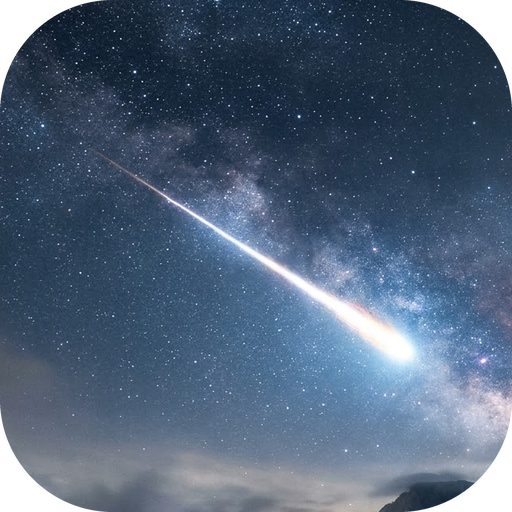
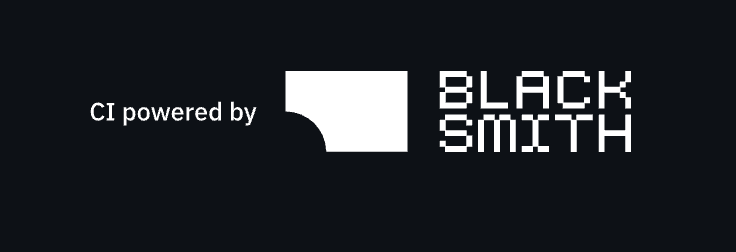

<div align="center">



# StarFall

### A YouTube Music client for Android, built around the music you actually listen to

</div>

> [!WARNING]
> **Regional restriction** – If YouTube Music is unavailable in your region, StarFall will not work without a VPN or proxy connecting to a supported region.

---

## About

StarFall is a free, open-source YouTube Music client for Android written in Kotlin with Jetpack Compose and Material 3. It is a fork of [Metrolist](https://github.com/MetrolistGroup/Metrolist) with a space theme, a listening **rank** system, a weekly **leaderboard**, a customisable **public profile**, animated backgrounds and a reworked Discord Rich Presence.

## Core features

**Playback and audio**
- Stream songs and videos from YouTube Music, with background playback
- Download and cache for offline listening
- Audio normalisation, tempo and pitch control, equaliser, crossfade, skip silence, sleep timer

**Lyrics and discovery**
- Live synced lyrics and AI-powered lyrics translation
- Personalised quick picks and speed dial
- Search songs, albums, artists, videos and playlists

**Library and account**
- Full library management and local playlists
- Import playlists, reorder songs in playlists and the queue
- YouTube Music sign-in with library sync

**Social**
- Listen together with friends in real time
- Last.fm scrobbling
- Discord Rich Presence (OAuth2 + Gateway, token kept encrypted on-device)
- Public StarFall profile (see below)

**StarFall extras**
- Falling-star launch animation and space-themed branding
- Animated space backgrounds (Nebula Drift, Starfield Night, Aurora Orbit, Solar Flare, Lunar Eclipse, Galaxy Spiral, Deep Space Void, Comet Trail)
- Swipe gestures and spring-physics micro-interactions across lists, cards and the player

## Ranks

Every second of *active playback* counts towards your total listening time. Time is stored on-device in every build; signing in (Google Play build) syncs it to your account, and the larger of your device and account totals is kept, so your rank follows you between devices. Pausing, buffering and being idle do not count.

| Tier | Rank | Hours needed |
|---:|---|---:|
| 1 | 🌌 Stardust | 0 h |
| 2 | ☄️ Meteor | 10 h |
| 3 | 🌠 Comet | 25 h |
| 4 | 🪨 Asteroid | 50 h |
| 5 | 🌙 Moon | 90 h |
| 6 | ⭐ Star | 150 h |
| 7 | 🪐 Planet | 230 h |
| 8 | 💥 Nova | 330 h |
| 9 | 🔴 Red Giant | 460 h |
| 10 | 🌟 Supernova | 620 h |
| 11 | ⚛️ Neutron Star | 800 h |
| 12 | ⚫ Black Hole | 950 h |

Reaching a new tier triggers a celebration animation. Your rank is shown on your **Profile** (tap your avatar at the top right of Home), on the leaderboard and in search results. It is always derived from listening hours, so a visited profile shows the same tier you would calculate yourself.

## Weekly leaderboard

- Available in the Google Play build after signing in with Google; joining is **opt-in** (*Join weekly leaderboard*)
- Ranks listeners by hours listened **during the current week**, not all-time
- A week runs **Monday 00:00 UTC to the following Monday 00:00 UTC**, so everyone shares one window; the board starts fresh each week
- Shows the top 50 plus your own position if you are outside the top 50
- Each entry shows your display name, avatar, weekly hours and rank badge
- Leaving the leaderboard stops weekly data being written; your all-time total is unaffected

## Public profile

Tap your avatar at the top right of **Home** to open your profile. It combines your rank, account, leaderboard and public profile in one place:

- Total listening hours, plus songs and artists listened to (on your own profile)
- Your current rank with progress to the next tier
- A display name (editable once every 7 days) and a biography
- Favourite playlists and other showcases

Find other listeners with the **StarFall profiles** chip in Search (prefix search by name), or tap a leaderboard entry, to visit their profile. Under **Settings → Privacy → Show my public profile** you can switch your profile off completely; when it is off, you disappear from search, nobody else can open it and your published profile data is removed. Your email is never published.

> [!NOTE]
> The public profile and leaderboard need the Google Play (`gms`) build with a Firebase project configured (`app/google-services.json`). The `foss` and `izzy` builds keep rank and profile editing fully on-device.

Firestore rules for profiles are in [`firebase/firestore.rules.example`](firebase/firestore.rules.example).

## Building

```bash
./gradlew :app:assembleFossDebug
```

The APK is written to `app/build/outputs/apk/universalFoss/debug/`. Requires JDK 21 and the Android SDK. For account features add your own `app/google-services.json`; for Last.fm add `LASTFM_API_KEY` and `LASTFM_SECRET` to `local.properties`.

## License

StarFall is licensed under GPL-3.0, see [LICENSE](LICENSE) and [NOTICE.md](NOTICE.md).

---

<div align="center">

<h1>Special Thanks</h1>

<h3>StarFall (a fork of Metrolist) stands on the shoulders of incredible open-source work.</h3>

<h3>Main Inspirations</h3>

<table>
  <thead>
    <tr>
      <th align="center">Project</th>
      <th align="center">Authors</th>
    </tr>
  </thead>
  <tbody>
    <tr>
      <td align="center"><strong>InnerTune</strong></td>
      <td align="center"><a href="https://github.com/z-huang">Zion Huang</a> · <a href="https://github.com/Malopieds">Malopieds</a></td>
    </tr>
    <tr>
      <td align="center"><strong>OuterTune</strong></td>
      <td align="center"><a href="https://github.com/DD3Boh">Davide Garberi</a> · <a href="https://github.com/mikooomich">Michael Zh</a></td>
    </tr>
  </tbody>
</table>

<h3>Libraries & Integrations</h3>

<table>
  <thead>
    <tr>
      <th align="center">Project</th>
      <th align="center">Contribution</th>
    </tr>
  </thead>
  <tbody>
    <tr>
      <td align="center"><a href="https://better-lyrics.boidu.dev"><strong>Better Lyrics</strong></a></td>
      <td>Time-synced lyrics with word-by-word highlighting & YouTube Music integration</td>
    </tr>
    <tr>
      <td align="center"><a href="https://github.com/MetrolistGroup/metroserver"><strong>metroserver</strong></a></td>
      <td>Listen-together real-time backend</td>
    </tr>
    <tr>
      <td align="center"><a href="https://github.com/aleksey-saenko/MusicRecognizer"><strong>MusicRecognizer</strong></a></td>
      <td>Music recognition feature & Shazam API integration</td>
    </tr>
    <tr>
      <td align="center"><a href="https://github.com/ZemerTeam/zemer-cipher"><strong>zemer-cipher</strong></a></td>
      <td>YouTube cipher deobfuscation and PoToken generation</td>
    </tr>
    <tr>
      <td align="center"><a href="https://www.blacksmith.sh"><strong>Blacksmith</strong></a></td>
      <td>High-performance GitHub Actions runners powering our CI</td>
    </tr>
  </tbody>
</table>

<br/>

<a href="https://www.blacksmith.sh">
  
</a>

<h3>We also thank the entire open-source community! For every library, tool, and API that powers this project.</h3>

</div>

---

<div align="center">

<h1>Disclaimer</h1>

This project is **not affiliated with, funded, authorized, endorsed by, or in any way associated** with YouTube, Google LLC, Metrolist Group LLC, or any of their affiliates and subsidiaries.

All trademarks, service marks, and intellectual property rights referenced in this project belong to their respective owners.

</div>
